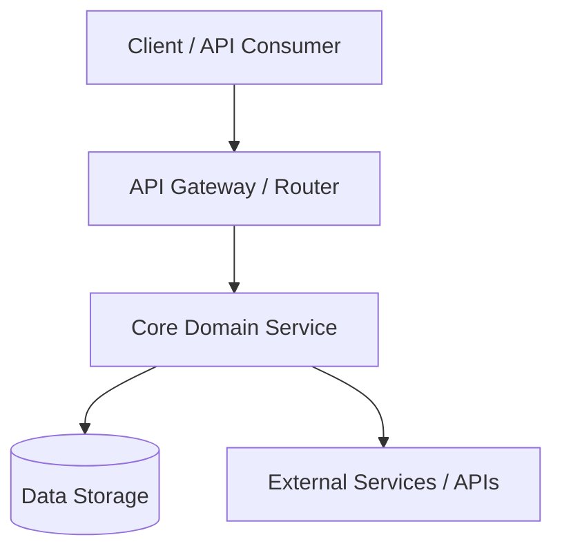

# Architecture Summary & High-Level Design

> **Purpose**: Provides AI agents with an instant high-level overview of system boundaries, directory layout, and data flow.

---

## 1. High-Level System Architecture


---

## 2. Directory Structure & Layout
```
├── ai-sdlc/            # AI-SDLC Core: principles, personas, templates, and memory
├── docs/               # Project documentation (PRDs, ADRs, Specs)
│   ├── prd/            # Product Requirements Documents
│   ├── adr/            # Architecture Decision Records
│   └── specs/          # Technical implementation plans
├── scripts/            # Utility scripts (e.g. sync-rules.py, build helpers)
├── src/                # Primary application source code (or language equivalent)
└── tests/              # Automated tests (unit, integration, e2e)
```

---

## 3. Data Flow & Invariants
- **Data Flow**: Requests flow from entry points (CLI / HTTP routes) -> Controllers / Handlers -> Domain Services -> Persistence.
- **Invariants**:
  - Domain models do not have direct knowledge of transport layers (HTTP/CLI).
  - All external inputs are validated at the perimeter before touching domain services.
